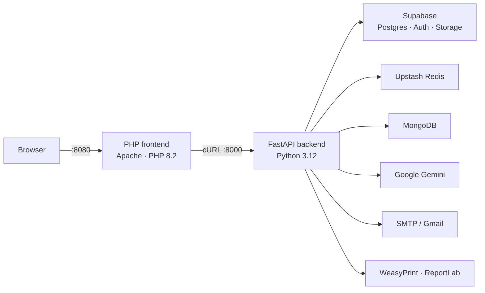

<p align="center">
  
</p>

<h1 align="center">FMS — Freight Management System</h1>

<p align="center">
  A containerized freight-forwarding CRM with a FastAPI backend and a PHP frontend.
</p>

<p align="center">
  <a href="https://github.com/SneakySep/FMS/actions/workflows/backend-ci.yml">
    
  </a>
  <a href="https://github.com/SneakySep/FMS/actions/workflows/frontend-ci.yml">
    
  </a>
  <a href="LICENSE">
    
  </a>
</p>

## Overview

FMS is a role-based freight management and customer relationship platform built for logistics sales teams. It combines a FastAPI service layer with a server-rendered PHP portal and integrates Supabase, Upstash Redis, MongoDB, Google Gemini, and SMTP for authentication, caching, chat, AI assistance, and transactional email.

The repository currently includes:

- **Sales agent portal** — dashboard, lead pipeline, lead detail drawer, quotation flow, and KPI strip.
- **Admin portal** — dashboard, customer accounts, account tickets, and BI analytics (descriptive, diagnostic, predictive, and prescriptive).
- **Super admin portal** — customer account creation, access restrictions, audit logs, and dashboard.
- **Authentication** — login, OTP verification, logout, and account lockout.
- **Backend APIs** — leads, inquiries, kanban, shipments, quotations, documents, campaigns, SLAs, notifications, chat, analytics, audit, security, and logistics integration.

## Features

| Area | Capabilities |
| --- | --- |
| Lead management | Create and filter leads, update pipeline status, view lead details, and generate quotations |
| Sales dashboard | Agent KPIs, lead counts, and pipeline snapshots |
| Admin analytics | Descriptive, diagnostic, predictive, and prescriptive reporting |
| Account management | Customer accounts, tickets, restrictions, and audit trails |
| Communication | Agent chat, AI-assisted chat, notifications, and SMTP email |
| Documents | Quotation PDFs, SLA contracts, and document delivery APIs |
| Logistics integration | Closed-won shipment hand-off through a protected API key |
| Authentication | Supabase-backed login, OTP verification, and role-aware sessions |

## Architecture



## Tech stack

| Layer | Technology |
| --- | --- |
| Backend | Python 3.12, FastAPI, Pydantic, Uvicorn |
| Frontend | PHP 8.2, Apache, Tailwind CSS, Font Awesome, vanilla JavaScript |
| Database & auth | Supabase (PostgreSQL, Auth, Storage) |
| Cache & OTP | Upstash Redis |
| Document store | MongoDB |
| AI | Google Gemini |
| Reporting | pandas, NumPy, scikit-learn, statsmodels |
| PDF generation | WeasyPrint, ReportLab |
| Email | SMTP (Gmail App Password recommended) |
| Containers | Docker, Docker Compose |
| CI | GitHub Actions |

## Repository structure

```text
FMS/
├── backend-api/
│   ├── app/
│   │   ├── config/            # Pydantic settings
│   │   ├── middleware/        # Email, SLA, quotation helpers
│   │   ├── routes/            # Auth, sales, admin, super admin, customer
│   │   ├── schemas/           # Request/response models
│   │   ├── service/           # Business logic and analytics
│   │   ├── supabase_config/   # Supabase, Redis, Gemini, Mongo clients
│   │   ├── templates/         # Email/PDF templates
│   │   └── test/              # Pytest suite
│   ├── Dockerfile
│   ├── pytest.ini
│   └── requirements.txt
├── frontend/
│   ├── assets/                # CSS, JavaScript, images
│   ├── src/
│   │   ├── components/        # Shared UI components
│   │   ├── config/            # Environment loader
│   │   ├── controllers/       # Page controllers
│   │   ├── helpers/           # API helpers
│   │   ├── includes/          # Header, sidebar, footer
│   │   ├── services/          # Sidebar and API services
│   │   └── views/             # Role-based pages and partials
│   ├── Dockerfile
│   ├── index.php
│   └── login.php
├── .github/workflows/         # Backend and frontend CI
├── docker-compose.yml
├── README.md
└── LICENSE
```

## Prerequisites

- [Docker Desktop](https://www.docker.com/products/docker-desktop/) with Docker Compose
- Git
- Optional for local development: Python 3.12 and PHP 8.2+

## Quick start

```bash
git clone https://github.com/SneakySep/FMS.git
cd FMS
```

Create the local environment files:

```bash
cp backend-api/.env.example backend-api/.env
cp frontend/.env.example frontend/.env
```

On Windows PowerShell:

```powershell
Copy-Item backend-api/.env.example backend-api/.env
Copy-Item frontend/.env.example frontend/.env
```

Fill in the credentials in both `.env` files, then start the stack:

```bash
docker compose up --build -d
```

| Service | URL |
| --- | --- |
| Frontend | http://localhost:8080 |
| Backend API | http://localhost:8000 |
| Swagger UI | http://localhost:8000/docs |
| ReDoc | http://localhost:8000/redoc |

Stop the stack with:

```bash
docker compose down
```

## Environment variables

### Backend (`backend-api/.env`)

| Variable | Required | Description |
| --- | --- | --- |
| `SUPABASE_URL` | Yes | Primary Supabase project URL |
| `SUPABASE_KEY` | Yes | Primary Supabase anon key |
| `SUPABASE_SERVICE_KEY` | Yes | Primary Supabase service-role key (server-side only) |
| `SUPABASE_JWT_SECRET` | Yes | Supabase JWT secret |
| `SUPABASE_URL_2` | Yes | Secondary Supabase project URL |
| `SUPABASE_KEY_2` | Yes | Secondary Supabase anon key |
| `SUPABASE_SERVICE_KEY_2` | Yes | Secondary Supabase service-role key |
| `UPSTASH_REDIS_REST_URL` | Yes | Upstash Redis REST endpoint |
| `UPSTASH_REDIS_REST_TOKEN` | Yes | Upstash Redis REST token |
| `SMTP_SENDER` | Yes | Sender email address |
| `SMTP_PASSWORD` | Yes | SMTP password or Gmail App Password |
| `GEMINI_API_KEY` | Yes | Google Gemini API key |
| `MONGODB_URL` | Yes | MongoDB connection string |
| `LOGISTIC_API_KEY` | Yes | Shared key for the logistics integration endpoint |

### Frontend (`frontend/.env`)

| Variable | Required | Description |
| --- | --- | --- |
| `APP_NAME` | No | Display name of the application |
| `APP_ENV` | No | Environment label (`development`, `production`, etc.) |
| `APP_URL` | No | Public URL of the frontend |
| `PUBLIC_API_URL` | Yes | API URL used by browser-side JavaScript |
| `INTERNAL_API_URL` | Yes | API URL used by PHP server-side cURL calls |
| `SUPABASE_URL` | No | Optional Supabase URL for client-side features |
| `SUPABASE_ANON_KEY` | No | Optional Supabase anon key for client-side features |
| `SESSION_SECRET` | Recommended | Long random value for PHP session security |

> Never commit the real `.env` files. Only the `.env.example` templates belong in Git.

## Local development

### Backend

```bash
cd backend-api
python -m venv .venv

# Windows
.venv\Scripts\activate

# macOS / Linux
source .venv/bin/activate

pip install -r requirements.txt
uvicorn app.main:app --reload --port 8000
```

### Frontend

```bash
cd frontend
php -S localhost:8080
```

When running the frontend outside Docker, set `INTERNAL_API_URL=http://localhost:8000` and `PUBLIC_API_URL=http://localhost:8000` in `frontend/.env`.

## Tests

Run the backend test suite:

```bash
cd backend-api
pytest app/test -v
```

Or inside the running backend container:

```bash
docker compose exec backend pytest app/test -v
```

Run the PHP syntax check used by CI:

```bash
cd frontend
find . -name "*.php" -print0 | xargs -0 -n1 php -l
```

## API documentation

FastAPI exposes interactive documentation at `/docs` and `/redoc` while the backend is running. Route groups include:

- `/api/auth`
- `/api/sales/*`
- `/api/v1/admin/*`
- `/api/super-admin/*`
- `/api/v1/customer/*`
- `/api/agent/chat`
- `/api/notifications`
- `/api/logistic`

## Security notes

- `.env` files are ignored by Git; use the provided `.env.example` templates.
- Generate long random values for `SESSION_SECRET` and `LOGISTIC_API_KEY`.
- Use a Gmail App Password rather than your Google account password.
- Keep `SUPABASE_SERVICE_KEY` and `SUPABASE_SERVICE_KEY_2` server-side only.
- Rotate all credentials before deploying to a production environment.
- Run the stack behind HTTPS and restrict CORS origins in `backend-api/app/main.py`.

## License

This project is licensed under the MIT License. See [LICENSE](LICENSE) for details.
